# Practica inicial de React: Testimonios con componentes y estado

Ingenieria de Software · Unidad 3 · Periodo AGO–DIC 2026
TecNM en Celaya

## Integrantes

- Uriel Flores Zarate
- Jose Manuel Ramos Iglesias

## Entorno de desarrollo

- Node.js: v24.11.1
- npm: 11.6.2
- Vite: 8.3.5
- React: 19.3.1

## Scripts disponibles

- `npm install`: Instala las dependencias del proyecto.
- `npm run dev`: Inicia el servidor de desarrollo local.
- `npm run build`: Genera la compilacion de produccion en dist/.
- `npm run preview`: Previsualiza localmente la compilacion.
- `npm run lint`: Ejecuta el analisis estatico con oxlint.

## Registro de avance

### Seccion 1 a 4: Entorno e inicializacion con Vite

- Driver: Uriel Flores Zarate
- Navigator: Jose Manuel Ramos Iglesias
- Acciones:
  - Verificacion de versiones de Node.js (v24.11.1) y npm (11.6.2).
  - Creacion del proyecto con plantilla React de Vite.
  - Instalacion de dependencias y verificacion de compilacion inicial con `npm run build`.

#### Preguntas de comprobacion previa

- **Diferencia entre un objeto y un arreglo de objetos**: Un objeto describe una sola entidad mediante propiedades clave-valor (por ejemplo, `{ id, nombre, cargo }`). Un arreglo de objetos es una coleccion ordenada que permite almacenar, iterar y acceder a multiples entidades.
- **Exportacion e importacion de data.js**: `export default testimonios` exporta el arreglo como el valor principal por defecto del modulo. Quien lo importa (`import testimonios from './data.js'`) recibe directamente la referencia sin necesidad de desestructuracion `{}`.
- **Uso de llaves en JSX (`{nombre}`)**: Las llaves indican a React que debe evaluar el contenido como una expresion dinamica de JavaScript, insertando su valor resultante en el arbol en lugar de tratarlo como texto literal.
- **Prediccion al pasar otro nombre al componente**: Al recibir nuevas props, React reejecuta la funcion del componente y concilia las diferencias en el DOM, actualizando unicamente el nodo de texto correspondiente.

### Seccion 5: Estructura y recorrido de la aplicacion

- Driver: Uriel Flores Zarate
- Navigator: Jose Manuel Ramos Iglesias
- Acciones:
  - Se estructuro el arbol de directorios segun el esquema de la guia (Figura 1), separando los componentes en `src/components/` y centralizando los estilos globales en `src/styles.css`.
  - Se configuro `public/fotos/` con 8 retratos en formato cuadrado (200x200 px con enfoque facial) para disponer de recursos locales sin depender de conectividad externa ni proveedores remotos.
  - Se prepararon los cascarones iniciales para `Testimonial.jsx`, `Controls.jsx` y el modulo `data.js`.
  - Se unifico el punto de entrada en `src/main.jsx`, encargandose de montar `App` dentro del nodo contenedor `#root` e importar `styles.css` una sola vez.

En la siguiente captura se observa la estructura de archivos en el explorador del proyecto, cumpliendo con la separacion entre componentes, fuentes de datos, recursos estaticos y configuracion:

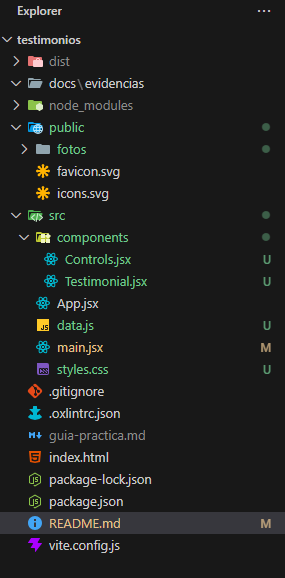

### Seccion 6: Datos y componente de presentacion

- Driver: Uriel Flores Zarate
- Navigator: Jose Manuel Ramos Iglesias
- Acciones:
  - Se definio el modulo `src/data.js` como un modulo nativo de JavaScript (`export default`) que contiene un arreglo con 8 objetos estructurados, vinculando cada registro a su respectiva imagen local en `/fotos/`:

```javascript
const testimonios = [
  {
    id: 1,
    nombre: "Ana Pérez",
    cargo: "Dirección",
    texto: "La herramienta facilita organizar nuestras tareas.",
    foto: "/fotos/ana.jpg",
  },
  // ... 7 registros adicionales con id unico del 2 al 8
];

export default testimonios;
```

- Se construyo el componente de presentacion `src/components/Testimonial.jsx`, el cual recibe el testimonio individual a traves de la prop `item`. Aplica desestructuracion limpia y genera marcado semantico accesible con texto alternativo contextual:

```jsx
export default function Testimonial({ item }) {
  if (!item) return null;

  const { nombre, cargo, texto, foto } = item;

  return (
    <article className="testimonial-card">
      
      <h2>{nombre}</h2>
      <p className="testimonial-role">{cargo}</p>
      <blockquote>{texto}</blockquote>
    </article>
  );
}
```

### Seccion 7: Montaje y primera tarjeta estatica
- Driver: Uriel Flores Zarate
- Navigator: Jose Manuel Ramos Iglesias
- Acciones:
  - Se implemento la primera version de `src/App.jsx` montando de forma estatica el primer elemento del arreglo (`testimonios[0]`):

```jsx
import testimonios from "./data.js";
import Testimonial from "./components/Testimonial.jsx";

export default function App() {
  return (
    <main className="app">
      <h1>Experiencias de nuestros usuarios</h1>
      <Testimonial item={testimonios[0]} />
    </main>
  );
}
```

- Se comprobo el funcionamiento del renderizado estatico y el flujo unidireccional de datos pasando inicialmente `testimonios[0]` (Ana Perez) y posteriormente intercambiando el indice por `testimonios[1]` (Luis Garcia) para verificar la reactividad ante el cambio de props.

En esta captura se muestra el montaje inicial de la primera tarjeta estatica renderizando a Ana Perez desde la posicion 0 del arreglo:

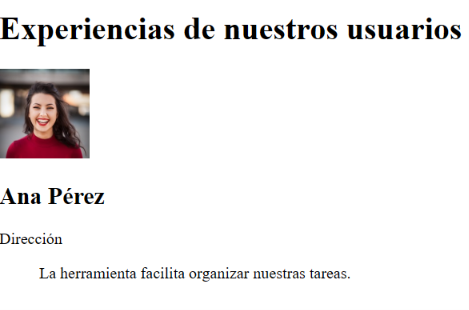

En esta captura se verifica la actualizacion de la interfaz al modificar manualmente la prop a la posicion 1 del arreglo, mostrando ahora a Luis Garcia:

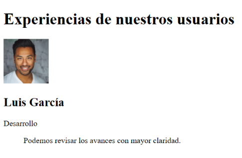

#### Detente y explica

- **¿Que archivo contiene la tarjeta y cual el objeto mostrado?**:
  `src/components/Testimonial.jsx` contiene la estructura visual y de marcado de la tarjeta, mientras que `src/data.js` almacena los objetos de datos estructurados que son leidos por `src/App.jsx`.
- **¿Que recibe `item` y por que el hijo no necesita importar `data.js`?**:
  `item` recibe como propiedad (_prop_) un unico objeto testimonio individual entregado por el componente padre (`App`). El componente hijo no necesita importar `data.js` porque su unica responsabilidad es presentar los datos que le son inyectados desde el exterior, desacoplandose del origen de la fuente de datos.
- **¿Que diferencia hay entre `main.jsx` y `App.jsx`?**:
  `src/main.jsx` es el punto de entrada de la aplicacion que conecta React con el DOM del navegador mediante `createRoot` sobre el elemento `#root`. `src/App.jsx` es el componente raiz de la jerarquia de React que define la logica, la estructura general y la coordinacion de los componentes visuales.
- **¿Que tendrias que copiar si no existiera el componente `Testimonial`?**:
  Habria que duplicar manualmente en cada lugar todo el bloque de marcado JSX (`<article>`, ``, `<h2>`, `<p>`, `<blockquote>`) y las operaciones de acceso a las propiedades del objeto, dificultando el mantenimiento y aumentando la redundancia del codigo.

### Seccion 8: Controles y estado de navegacion
- Driver: Uriel Flores Zarate
- Navigator: Jose Manuel Ramos Iglesias
- Acciones:
  - Se implemento el componente `src/components/Controls.jsx` con tres botones accesibles que comunican eventos al componente superior a traves de callbacks (`onPrev`, `onNext`, `onRandom`).
  - Se integro el hook `useState(0)` en `src/App.jsx` para gestionar el indice del testimonio activo.
  - Se aplicaron actualizaciones de estado funcionales (`setIndex(actual => ...)`) con aritmetica modular para garantizar navegacion ciclica: `(actual + 1) % total` para avanzar y `(actual - 1 + total) % total` para retroceder.
  - Se diseño el algoritmo de seleccion aleatoria calculando un desplazamiento `salto = 1 + Math.floor(Math.random() * (total - 1))`, asegurando que al existir dos o mas registros nunca se seleccione el testimonio actualmente visible.
  - Se incluyo una clausula de guardia para colecciones vacias (`total === 0`) y un contador de posicion accesible con `aria-live="polite"`.

```jsx
export default function Controls({ onPrev, onNext, onRandom }) {
  return (
    <div className="controls">
      <button type="button" onClick={onPrev}>Anterior</button>
      <button type="button" onClick={onNext}>Siguiente</button>
      <button type="button" onClick={onRandom}>Aleatorio</button>
    </div>
  );
}
```

#### Traza obligatoria con tres registros

| Accion | Indice antes | Indice despues | Posicion visible |
| :--- | :---: | :---: | :---: |
| Inicio | — | 0 | 1 de 3 |
| Siguiente | 0 | 1 | 2 de 3 |
| Siguiente | 2 | 0 | 1 de 3 |
| Anterior | 0 | 2 | 3 de 3 |

#### Evidencias de navegacion e interaccion

En esta captura se aprecian los tres botones de control (`Anterior`, `Siguiente`, `Aleatorio`) y el contador de posicion reflejando el estado inicial con el testimonio 1 de 8:

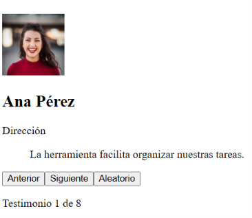

En esta captura se evidencia el funcionamiento del boton `Siguiente`, pasando del primer registro al testimonio 2 de 8 (Luis Garcia):

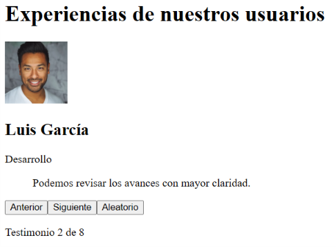

En esta captura se observa el resultado de presionar `Aleatorio`, seleccionando un registro completamente distinto al actual (testimonio 7 de 8, Sofia Castro):

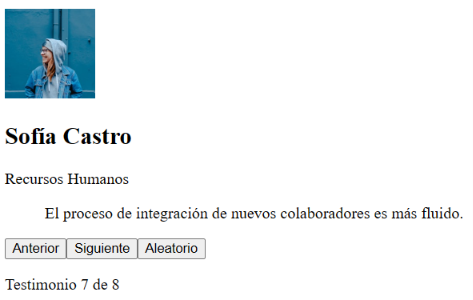

En esta captura se demuestra la navegacion en reversa con el boton `Anterior`, retrocediendo de la posicion 7 a la posicion 6 de 8 (Javier Ramos):

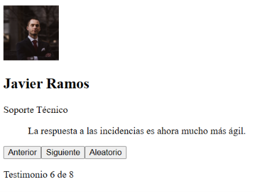

### Seccion 9: Estilos y accesibilidad basica

- Driver: Jose Manuel Ramos Iglesias
- Navigator: Uriel Flores Zarate

- Acciones:
  - Se aplicaron los estilos globales definidos en `src/css/styles.css`, estableciendo una tipografia del sistema, colores con contraste, fondo claro y un contenedor centrado con ancho maximo de 560 px.
  - Se diseño la tarjeta de testimonio con fondo blanco, bordes redondeados, sombra, espaciado interno y ajuste de palabras para evitar desbordamientos en textos extensos.
  - Se dio formato circular a las fotografias mediante `border-radius: 50%` y `object-fit: cover`, conservando una presentacion uniforme para todos los testimonios.
  - Se organizaron los controles con `display: flex`, `flex-wrap: wrap` y separacion entre botones para conservar su legibilidad en pantallas reducidas.
  - Se establecio una altura minima de 44 px para los botones, un estado visual al pasar el cursor y un indicador visible de enfoque con `:focus-visible`, facilitando la navegacion con teclado.
  - Se agrego un ajuste responsivo con `@media (max-width: 360px)` para reducir el espaciado de la tarjeta en dispositivos pequenos.
  - Se conservaron elementos semanticos y accesibles: `main`, `article`, `h1`, `blockquote`, texto alternativo descriptivo en las fotografias y `aria-live="polite"` para anunciar el cambio de posicion sin interrumpir al usuario.

#### Evidencia visual de los estilos

En esta captura debe mostrarse la aplicacion completa con la tarjeta de testimonio, la fotografia circular, los botones y el contador de posicion:

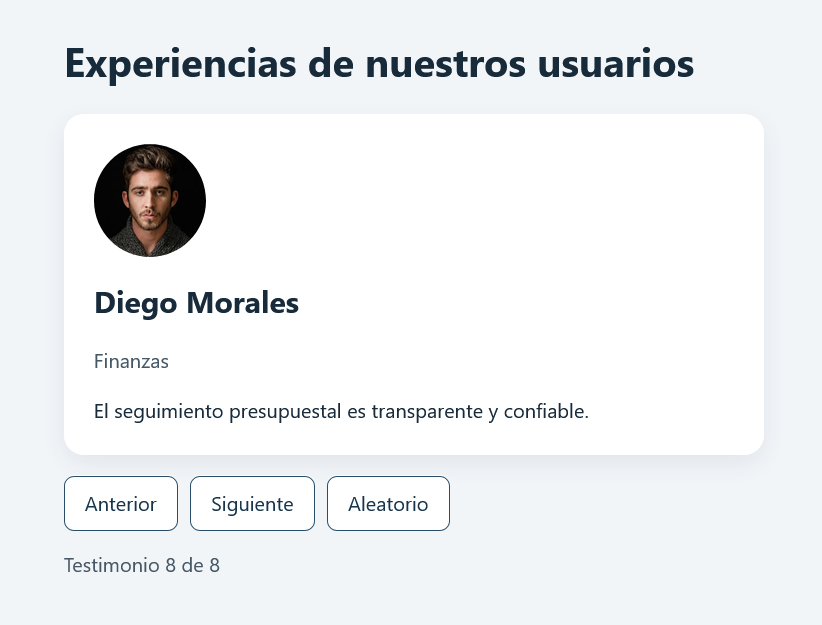

#### Evidencia de accesibilidad y enfoque

Se muestra uno de los botones seleccionado mediante el teclado, con el contorno visible generado por `button:focus-visible`:

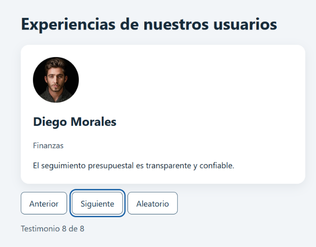

#### Evidencia de adaptacion responsiva

Se muestra la interfaz en una ventana de hasta 360 px de ancho, comprobando el ajuste del espaciado de la tarjeta y el acomodo de los botones:

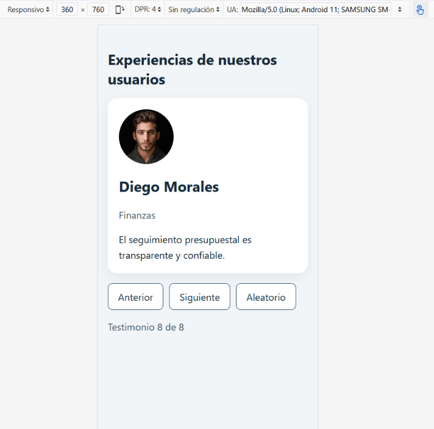

### Seccion 10: Casos de prueba de la etapa basica

- Driver: Jose Manuel Ramos Iglesias
- Navigator: Uriel Flores Zarate
- Datos utilizados: 8 testimonios cargados desde `src/data.js`.
- Objetivo: comprobar el estado inicial, la navegacion ciclica, la seleccion aleatoria, los casos limite, la adaptacion responsiva y la compilacion del proyecto.

#### Matriz de pruebas

| ID | Caso | Procedimiento | Resultado esperado | Resultado |
| :--- | :--- | :--- | :--- | :---: |
| P01 | Inicio | Cargar la aplicacion. | Se muestra Ana y el contador indica `Testimonio 1 de 8`. | ✔ |
| P02 | Siguiente | Desde Ana, presionar `Siguiente`. | Se muestra Luis y el contador cambia a `Testimonio 2 de 8`. | ✔ |
| P03 | Limite superior | Llegar a Sofia, el testimonio 8, y presionar `Siguiente`. | La navegacion regresa a Ana, posicion 1 de 8, sin error. | ✔ |
| P04 | Limite inferior | Desde Ana, presionar `Anterior`. | La navegacion llega a Sofia, posicion 8 de 8, sin error. | ✔ |
| P05 | Aleatorio | Presionar `Aleatorio` desde una posicion valida. | Se selecciona otro registro valido y el contador se actualiza. | ✔ |
| P06 | Un registro | Sustituir temporalmente el arreglo por un solo objeto. | La tarjeta permanece estable y no se producen errores; los controles no cambian la posicion. | ✔ |
| P07 | Sin registros | Sustituir temporalmente el arreglo por `[]`. | Se muestra `No hay testimonios disponibles.` y no se renderizan controles. | ✔ |
| P08 | Ampliacion de datos | Restaurar los datos completos y verificar todos los registros. | La navegacion recorre los 8 testimonios y el contador conserva el rango 1–8. | ✔ |
| P09 | Presentacion | Probar anchos de 360 px, 760 px y 1280 px; usar teclado y texto largo. | La interfaz se adapta, conserva la legibilidad y muestra el enfoque visible. | ✔ |
| P10 | Compilacion | Ejecutar `npm run build`. | La compilacion termina correctamente y no reporta errores de aplicacion. | ✔ |

#### P01 y P02: estado inicial y avance

Al cargar la aplicacion se presenta Ana Perez en la primera tarjeta y el contador indica `Testimonio 1 de 8`. Al presionar `Siguiente`, se muestra Luis Garcia y la posicion cambia a `2 de 8`.


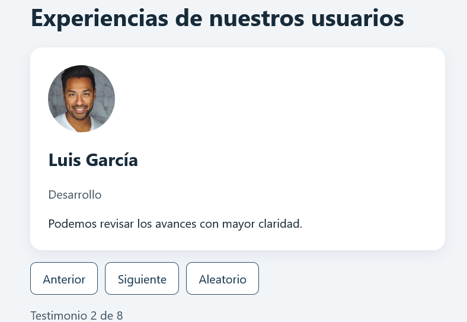

#### P03 y P04: limites de navegacion

Las pruebas de limite son exitosas porque la navegacion utiliza aritmetica modular:

- En el ultimo registro, `(actual + 1) % total` devuelve el indice `0` y regresa al primer testimonio.
- En el primer registro, `(actual - 1 + total) % total` devuelve el ultimo indice y regresa al octavo testimonio.

#### P05: seleccion aleatoria

La funcion `random` evita seleccionar el registro actual cuando existen dos o mas testimonios. Calcula un desplazamiento entre `1` y `total - 1`, lo suma al indice vigente y aplica el modulo del total. Por ello, el nuevo indice siempre es valido y diferente del anterior.

#### P06: coleccion con un registro

Para comprobar el caso limite se puede usar temporalmente este contenido en `src/data.js`:

```javascript
const testimonios = [
  {
    id: 1,
    nombre: 'Ana Perez',
    cargo: 'Direccion',
    texto: 'La herramienta facilita organizar nuestras tareas.',
    foto: '/fotos/ana.jpg',
  },
];

export default testimonios;
```

La tarjeta se mantiene visible sin errores. `Siguiente` y `Anterior` conservan el indice `1`.


#### P07: coleccion vacia

Al cambiar temporalmente el arreglo por `[]`, muestra el mensaje `No hay testimonios disponibles.` y evita renderizar una tarjeta o controles que no tendrian datos validos.


#### P08: ampliacion y restauracion de datos

Al restaurar los 8 objetos de `src/data.js`, el contador comienza en `Testimonio 1 de 8` y se mantiene dentro del rango durante los recorridos hacia adelante, hacia atras y aleatorios.

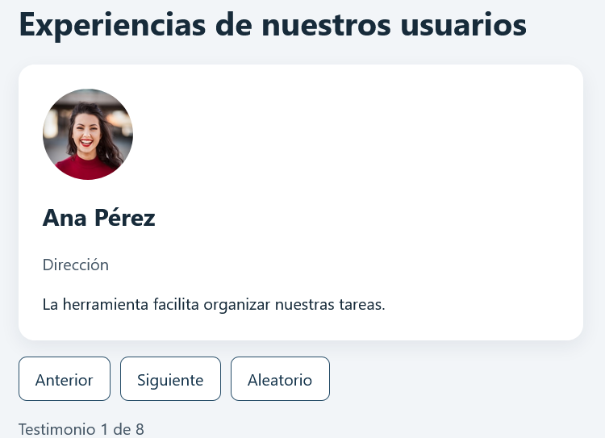

#### P09: presentacion responsiva y teclado

Se verifico la interfaz en tres tamaños de ventana:

- **360 x 760 px:** se aplica el espaciado reducido de la tarjeta.
- **760 x 760 px:** la tarjeta conserva una lectura comoda y los controles permanecen alineados.
- **1280 x 760 px:** el contenido se mantiene centrado dentro del ancho maximo de 560 px.
- **Teclado:** los botones reciben el foco en orden.

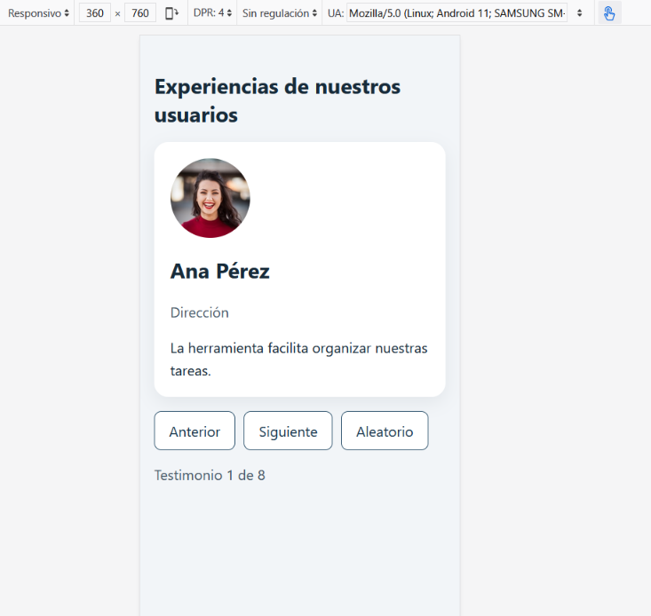

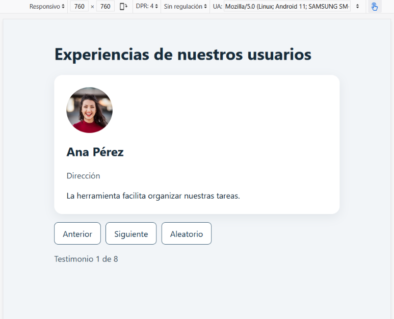

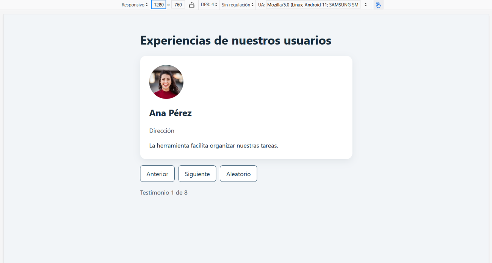

#### P10: compilacion

Se ejecuto `npm run build` para comprobar que la aplicacion puede transformarse en una compilacion de produccion sin errores.

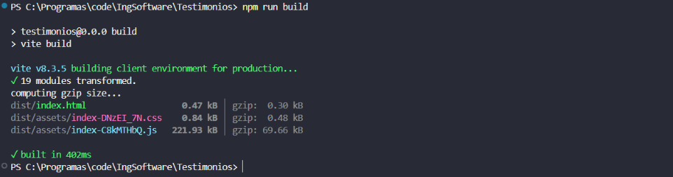

#### Evidencias de comprension

Estas evidencias complementan los casos de prueba y demuestran la comprension de componentes, props y estado. Se mantienen separadas de cualquier prueba de autoplay; la aplicacion actual se prueba mediante interaccion manual con los controles.

##### Flujo de informacion entre App y sus hijos

```text
src/data.js
    |
    v
App.jsx
  |  item={testimonios[index]}
  +-----------------------> Testimonial.jsx
  |                           Renderiza foto, nombre, cargo y texto
  |
  +-- onPrev={prev} -------> Controls.jsx
  +-- onNext={next} -------> Controls.jsx
  +-- onRandom={random} ---> Controls.jsx
                              Ejecuta el callback del boton
```

- `src/data.js` exporta el arreglo de testimonios.
- `App.jsx` importa los datos, conserva `index` con `useState` y selecciona el testimonio activo.
- `App.jsx` envia el objeto seleccionado a `Testimonial.jsx` mediante la prop `item`.
- `App.jsx` envia las funciones `prev`, `next` y `random` a `Controls.jsx` mediante props.
- `Controls.jsx` no modifica directamente el estado; ejecuta el callback recibido.
- `Testimonial.jsx` recibe `item` y muestra sus propiedades.

##### Recorrido de clic, callback, estado y DOM

Al presionar `Siguiente`, el flujo es:

```text
clic en "Siguiente"
  -> Controls ejecuta onNext
  -> App recibe la llamada en next
  -> setIndex(actual => (actual + 1) % total)
  -> React actualiza el estado
  -> App se renderiza nuevamente
  -> Testimonial recibe otro item
  -> React confirma los cambios en el DOM
```

##### Control del limite del indice

No se utiliza `testimonios[index + 1]` sin limite porque, al llegar al ultimo elemento, se intentaria leer una posicion inexistente. La expresion `(actual + 1) % total` regresa al indice `0`; de forma equivalente, `(actual - 1 + total) % total` permite retroceder desde el primer elemento hasta el ultimo.

La funcion aleatoria aplica la misma proteccion: calcula un desplazamiento distinto de cero y despues aplica `% total`, por lo que siempre obtiene un indice valido y diferente del actual cuando existen al menos dos registros.

##### Error identificado y comprobacion de la solucion

Se identifico el riesgo de perder la navegacion al superar el ultimo indice. Se corrigio utilizando actualizaciones funcionales y aritmetica modular:

```jsx
function next() {
  setIndex(actual => (actual + 1) % total);
}

function prev() {
  setIndex(actual => (actual - 1 + total) % total);
}
```

La solucion se comprobo recorriendo desde la primera posicion hacia atras y desde la ultima hacia adelante. Tambien se verificaron las colecciones de un elemento y vacia para confirmar que no aparecieran errores visibles.
